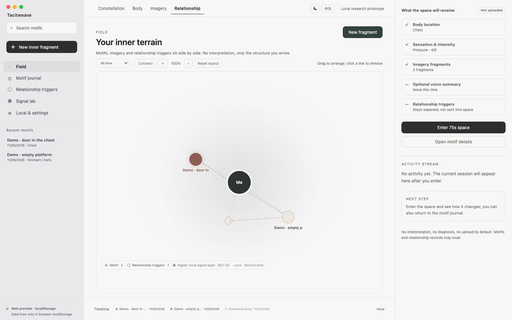

# Familiweave

[中文](README.md) | **English**

> A local-first symbolic interface for the pre-verbal layer.
>
> An enterable, exit-able, self-interpreted space for inner experience.



Familiweave is a public research project initiated by **Inceptless** about **brain-computer interfaces and the deep subconscious**.

It is not trying to build a “therapist chatbot”. It does not claim to read the subconscious. It starts from a narrower, testable question:

> Before language is formed, can the body, imagery and relational patterns be held first — and turned into a symbolic experience that only the person can complete?

## 1. Why BCI, not another chat box

As AI takes over explicit knowledge, logical reasoning, language and external execution, **reason and language inflate**. People still feel empty, tense in the body, and stuck in the same relational loop. But these experiences are often pre-verbal:

- an unclear heaviness in the chest
- a recurring wet corridor
- a freeze in the body at a relational moment
- a feeling named only afterwards

LLMs are built on tokens. Implicit memory, attachment reactions and somatic states are more **pre-verbal, associative and affective**. Asking someone to “put it into words” often compresses it into a label like “I am anxious”.

Familiweave does not replace language. It adds an entrance before language: **body location, image choice, relationship triggers, optional physiological/audio signals, then a symbolic space.**

## 2. What we build

### 2.1 Pre-verbal capture

- Body map: head, jaw, throat, shoulders, chest, stomach/belly, back, hands, legs
- Sensation, intensity, breath
- Eight abstract image fragments; choose 1–3
- Optional 8-second local voice summary (volume/pause; no raw audio)
- No free-text interpretation; no need to name it first

### 2.2 Symbolic space

The capture becomes an `InnerPlan`, then a 75-second encounter or 180-second space:

- doors, corridors, water, houses, forest, stations, mirrors or fields
- an optional shadow-like presence, or none
- approach, stay, leave
- no interpretation, no score, no diagnosis

### 2.3 Deep motifs and relationships

- **Motif journal**: the user names it, saves it, deletes it
- **Relationship triggers**: user-written situations, moments, body reactions and automatic responses
- Descriptive counts only; no partner inference, matching or attachment typing
- Everything stays local by default

### 2.4 BCI signal layer

- **BCI-1**: device-agnostic `SignalSource`, LSL-style simulator, event timeline
- **BCI-2**: localhost-only WebSocket bridge for `hello/sample/samples` JSON
- No implant, no neural decoding, no clinical claims
- References open ecosystems: OpenBCI, BrainFlow, LSL, MNE. Neuralink’s public repo is mainly the data platform `datarepo`, not an N1 SDK

See [BCI open-source landscape](docs/vision/bci-open-source-landscape.md), [BCI-1](docs/vision/bci-1-signal-layer.md) and [BCI-2](docs/vision/bci-2-device-bridge.md).

## 3. Current prototype

| Layer | Implemented |
| --- | --- |
| v0 somatic capture | Body map + sensation/intensity/breath + image fragments |
| v1 motif journal | Local naming, save, delete, export |
| v2 relationship triggers | Self-authored moments/reactions, map, descriptive counts |
| v3 voice summary | 8s volume/pause; explicit consent; no raw audio |
| BCI-1 | Signal source contract, simulator, local event timeline |
| BCI-2 | Local WebSocket device bridge contract |
| Desktop shell | Tauri 2 + Rust; SQLite; app-data file sandbox |
| Bilingual | Chinese / English UI switch |
| Data | Local SQLite or browser localStorage; export/import/delete |

Currently **not** implemented:

- real BCI hardware validation
- an LSM model
- automatic relationship inference
- diagnosis, therapy or memory recovery
- clinical or human-efficacy evidence

## 4. Architecture

```text
body / imagery / relationship / optional signals
        │
        ▼
SomaticCapture + SignalTrace
        │
        ▼
InnerPlan
motifs · pacing · figure · space/sound/light prompts · safety
        │
        ▼
EpisodePlan (kind: inner)
        │
        ▼
WorldRenderer (symbolic today; Genie 4 later)
        │
        ▼
75s encounter / 180s space + local record
```

- `InnerPlan`: symbolic director layer.
- `EpisodePlan`: persisted plan envelope.
- `WorldRenderer`: renderer seam; local symbolic today.
- `SomaticSignalSource` / `SignalTrace`: device-agnostic signal seam.
- `CaptureProvenance`: provenance for non-deterministic captures.
- Tauri Rust host: file sandbox, SQLite, packaging; the frontend uses `invoke`.

## 5. BCI and LSM path

Familiweave treats BCI as an **optional signal entrance**, not a product premise.

| Stage | Content | Status |
| --- | --- | --- |
| BCI-0 | Local voice summary + self-report + imagery | Implemented |
| BCI-1 | Device-agnostic signal layer + LSL simulator | Implemented |
| BCI-2 | Local WebSocket bridge | Contract/UI only; no hardware validation |
| BCI-3 | Consented OpenBCI/BrainFlow/LSL research | Not started |
| LSM | Cross-modal somatic–imagery–relationship research model | Direction, not a trained model |
| Clinical | Work with ethics/clinical partners | Not started |

**LSM is a research narrative here, not a technical promise.** Without real, consented, deletable data, nobody should claim to “read the subconscious”.

## 6. How we handle the deep subconscious

We do not treat the “deep subconscious” as an object the system can own. It is the user’s own **pre-verbal layer of meaning**.

Therefore:

- no interpretation: no dream dictionary, no “you actually mean…”
- no diagnosis: not a test, therapy or medical device
- no memory recovery: no repressed-memory suggestions, no false memories
- no scoring: no subconscious health score, no relationship match score
- no inference about others: relationship triggers only map what the user wrote
- no dependency loops: no streaks, no “someone is waiting for you”
- meaning stays with the user: the system offers form and open questions only

## 7. Privacy and boundaries

- Local by default: no server, no account, no sync
- Tauri stores motifs/relationship triggers in SQLite; web preview falls back to localStorage
- Voice stores summaries only, not recoverable audio
- All data can be exported, imported and deleted
- In acute distress, self-harm or harm-to-others risk, stop and seek real support
- Real device signals require consent, deletion, disconnect and safety review first

## 8. Run locally

Requirements: Node.js 22+, pnpm 10, Rust toolchain; on macOS, Tauri needs Xcode Command Line Tools.

```sh
pnpm install
pnpm dev          # web preview
pnpm tauri:dev    # Tauri 2 desktop shell
```

Checks:

```sh
pnpm test
pnpm build
pnpm check:symbolic-path
pnpm rust:test
cargo test --manifest-path apps/desktop/src-tauri/Cargo.toml
```

Optional tools:

```sh
pnpm inner:storyboard --fragment "a corridor ending in a door" --format encounter
pnpm measure:browser
pnpm measure:browser:full
```

Desktop build:

```sh
pnpm tauri:build --bundles app
```

The current artifact is ad-hoc signed for local validation; Developer ID signing and notarization need an Apple certificate.

## 9. Project map

- [`src/somatic.ts`](src/somatic.ts) — body regions, sensations, breath, image fragments.
- [`src/somatic-entry.tsx`](src/somatic-entry.tsx) — v0 body-map entry.
- [`src/inner.ts`](src/inner.ts) — `InnerPlan`, encounter/space/capture plans.
- [`src/symbolic-renderer.tsx`](src/symbolic-renderer.tsx) — 75s encounter / 180s space.
- [`src/motif-journal.ts`](src/motif-journal.ts) — local motif storage.
- [`src/relationship.ts`](src/relationship.ts) — user-authored relationship triggers.
- [`src/signal-source.ts`](src/signal-source.ts) — BCI signal layer and LSL simulator.
- [`src/device-signal-source.ts`](src/device-signal-source.ts) — local device bridge.
- [`src/local-store.ts`](src/local-store.ts) — SQLite/localStorage snapshot.
- [`src/desktop-shell.tsx`](src/desktop-shell.tsx) — three-pane workspace.
- [`src/i18n.tsx`](src/i18n.tsx) — Chinese/English UI.
- [`apps/desktop/src-tauri/`](apps/desktop/src-tauri/) — Tauri 2 Rust host.
- [`docs/inner/`](docs/inner/) — formats, v0–v3 and capture boundaries.
- [`docs/vision/`](docs/vision/) — BCI landscape, BCI-1/2, LSM/relationship path.
- [`docs/desktop-shell.md`](docs/desktop-shell.md) — desktop shell, SQLite and signing.

## 10. Roadmap

- **Now**: v0–v3 local prototype, BCI-1/2 seams, Tauri shell, SQLite, bilingual UI.
- **Next**: real-device voice validation; real OpenBCI/LSL bridge; visual QA of the Tauri window.
- **Research**: consented multimodal small samples; first ask whether signals and self-report correspond stably, not promise efficacy.
- **Long term**: LSM as a research agenda; relationship topology remains user-authored; clinical work only with ethics and clinical partners.

## 11. Research questions

1. Can a symbolic space give form to pre-verbal experience without interpreting it?
2. When people use the body and image choice instead of words, do they get closer to “what cannot be said”?
3. Does a 75s / 180s boundary make people safer, or more distant?
4. Is there a stable, reproducible correspondence between multimodal signals and self-report?
5. Who is this for — and who should not use it?

## 12. License

Apache License 2.0. See [LICENSE](LICENSE).

## 13. Initiator

Familiweave is initiated by **Inceptless**.
