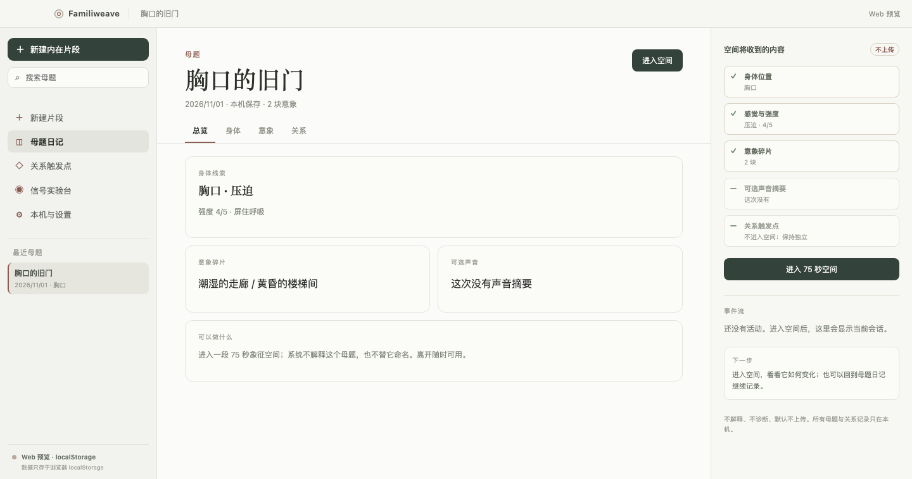

# Familiweave

> 为不可言说的内在经验，提供一个可进入、可退出、可自己解释的象征空间。

Familiweave 是一个关于内在经验的公开探索项目，由 **Inceptless 公司**发起。

有些经验很难被语言装下：反复出现的梦、说不清的地点、身体里的某种感觉、一段关系的余温、一个人不在场之后留下的空白。我们通常只能用“说不上来”来描述它们。

Familiweave 不解释这些经验，也不声称知道它们“真正意味着什么”。它的一个基本动作，是把它们变成一段象征空间——有门、走廊、水、房子、车站、镜子或田野，有一个影子般的存在，有几段声音与光。你可以进入、靠近、停留，也可以随时离开。

现在，你也可以不从语言开始：点按身体、选择几块意象，让系统把它们变成一段空间。

## 起点：不可言说

我们不是从“如何解释一个梦”开始的。我们从一个更基础的问题开始：

> **那些还没有形成语言的内在经验，能不能有一个可以被经历、而不被定义的形式？**

梦、艺术、仪式都在做这件事。Familiweave 想用可交互的空间做一次很小的尝试：给形式，不给结论。

失去、距离与关系变化也是重要的入口——它们都会留下无法言说的东西。

## 三个原则

1. **象征，不解释。**
   系统提供空间、声音、光和节拍；不提供梦的字典、心理诊断或“你潜意识里其实……”的断言。

2. **意义归用户。**
   用户可以觉得它像什么，也可以什么都不觉得。系统不评分、不分析、不纠正用户的感受。

3. **有限，可退出。**
   一次相遇是 75 秒，一个空间是 180 秒；不要求每天回来，不制造“对方在等你”。离开也是体验的一部分。

## 不止一种形式

“相遇”只是其中一种时长与结构。Familiweave 的底层是「象征空间」而不是「相遇产品」；同一个核心还可以是：

| 形式 | 结构 | 当前状态 |
| --- | --- | --- |
| 相遇 | 75 秒弧线，可进入/停留/离开 | 当前原型 |
| 空间 | 没有明确起承转合，可以待着 | 当前原型 |
| 仪式 | 短、可重复、有明确开始与结束 | 计划 |
| 物件 | 把一段内在经验做成可带走的视觉/声音物 | 计划 |
| 档案 | 把碎片放成一片可浏览的地形，不要求相遇 | 计划 |

详细边界见 [内在体验的形式](docs/inner/formats.md)。

## 这是什么，不是什么

**它是：**

- 一个“内在经验”的导演工具：一段梦、画面或感觉，变成有母题、节拍、影子与提示词的象征空间。
- 一个可插拔的渲染层：当前是本地 symbolic 渲染器；未来可以接 Genie 4 等生成式世界模型。
- 一个可追溯的计划：`InnerPlan` 与 `EpisodePlan` 记录母题、节拍、安全字段与渲染器。

**它不是：**

- 不声称与任何人真实沟通、传讯，也不声称“读取潜意识”。
- 不是梦境解释器、心理测试、治疗或诊断工具。
- 不是无限聊天陪伴、社交网络或情感替代品。
- 不是写实克隆；不做长相、声音或人格的写实复刻。

## 一次内在相遇如何发生

```
一段梦 / 画面 / 感觉 / 地点
        │
        ▼
InnerPlan
母题 · 75 秒情绪弧 · 影子 · 空间/声音/光/镜头提示词 · 安全约束
        │
        ▼
EpisodePlan（kind: inner）
        │
        ▼
symbolic 渲染器
        │
        ▼
75 秒相遇 / 180 秒空间；不解释、不评分、不诊断
```

- **导演层决定“发生什么”**：母题、影子、节拍与提示词；不在提示词里放入用户原文。
- **渲染层决定“看起来怎样”**：当前是本地 symbolic；Genie 4 等未来接入。
- **捕获决定“如何留下”**：非确定性成片保存 hash、模型、提示词与时间；当前捕获 schema 已定义，尚未接入实际生成。

## 当前状态

| 部分 | 状态 |
| --- | --- |
| 输入 | 躯体地图 + 感觉/强度/呼吸 + 意象碎片（v0）；也可用文字 |
| 形式 | 75 秒相遇、180 秒空间 |
| 内在导演层 | `InnerPlan`：母题、影子、节拍、空间/声音/光/镜头提示词、安全字段 |
| 计划信封 | `EpisodePlan`：`kind: inner`，只写入 `inner` |
| 象征渲染器 | `symbolic`：CSS/DOM，无声，可进入/停留/离开 |
| 捕获与出处 | `CaptureProvenance` schema + 捕获回放渲染器；尚无实际生成接入 |
| 同意与隐私 | 用途绑定 consent；梦、感觉与真实资料默认不上传 |
| 评估工具 | Rust `familiweave-ops`：实验日志校验与汇总 |
| Genie 4 | 适配器接口 + Rust 配置检查；没有网络调用 |
| 本地持久化 | Tauri 下母题/关系触发点经 `invoke` 写入 SQLite；Web 预览回退 `localStorage`；可整体导出/导入/删除 |
| 桌面外壳 | Tauri 2 三栏工作台；Rust 宿主提供 app data 文件沙箱与 SQLite 持久化；未签名 `.app` 已构建，窗口已启动 |

当前是**本地研究原型**：无声、无服务端保存、无临床与真人验证。

## 当前可以体验什么

- **从身体开始（默认）**：点按身体位置，选择感觉、强度、呼吸，再选 1–3 块意象；生成 75 秒相遇。
- **用文字**：输入一段梦/画面/地点/感觉；选择 75 秒相遇或 180 秒空间。
- **示例**：直接进入相遇或空间示例。
- **本机母题日记**：给这次感觉命名，可选择仅保存在本机；支持删除与导出 JSON。
- **关系触发点**：记录你注意到的触发瞬间、身体反应与自动反应；只画你自己的地图，并显示字段计数（不解释、不推断对方、不做匹配）。
- **可选本机声音测量**：8 秒音量/停顿摘要；明确同意、不保存原始音频、不上传。
- **本机数据**：可整体导出母题、关系触发点与声音摘要，或一键删除；可导出本机事件时间轴。
- **BCI-1 信号实验台**：15 秒 LSL 风格模拟信号，验证采样与时间轴；明确标注模拟，不采集真实神经数据。
- **BCI-2 设备桥接**：仅连接本机 WebSocket 桥接；需明确同意，原始信号默认不保存；真实硬件尚未验收。
- **安全**：不解释、不评分、不诊断；离开随时可用。

v0 不会测量潜意识或生理信号，也不会把意象解释成某段记忆。详细边界见 [v0：躯体地图 + 意象碎片](docs/inner/v0-somatic-capture.md)。

## 桌面外壳

前端已经收进 Tauri 2 三栏工作台：左侧导航与最近母题，中间捕获/母题详情，右侧“空间将收到的内容”。Rust 宿主在 `apps/desktop/src-tauri` 管理 app data 文件沙箱、SQLite 持久化与打包配置；配色参考 inceptless 的纸面/墨色三栏。



```sh
pnpm tauri:dev
```

详见 [桌面外壳](docs/desktop-shell.md)。未签名 `.app` 已构建并启动；正式签名、公证与安装包尚未验收。

## 技术栈

以 **TypeScript + Rust** 为主：

| 层 | 技术 |
| --- | --- |
| Web / 空间 | TypeScript、React 19、Vite、CSS/DOM |
| 桌面外壳 | Tauri 2 + Rust 宿主（文件系统、SQLite、沙箱、打包） |
| 导演 / 分镜 / 业务类型 | TypeScript：`InnerPlan`、`EpisodePlan`、`WorldRenderer`、manifest、consent |
| 文件与评估工具 | Rust：`familiweave-ops`（捕获 hash/verify、实验日志校验、Genie 配置检查） |
| 模型与媒体 | 未来按需接入；当前 symbolic 路径不加载模型、不初始化音频 |

Rust 负责确定性强、文件型、无 UI 的操作。当前前端不连接服务端；旧的资料准备与三维服务已移除。

## 隐私、伦理与边界

- **不解释、不诊断**：不提供梦的字典、心理测试或“你潜意识里其实……”的断言。
- **不声称读取潜意识**：系统只提供空间与开放问题，意义由用户完成。
- **不做记忆恢复**：不暗示被压抑的记忆，不制造虚假记忆；不处理急性创伤。
- **不做写实克隆**：不做长相、声音或人格的写实复刻。
- **默认本地**：梦、感觉与真实资料默认不上传；当前没有服务端保存。
- **不替代真实帮助**：涉及自伤、他伤或急性痛苦时，应停止体验并寻求现实中的专业帮助。
- **当前验证边界**：以合成资料、本地浏览器为主；内在共鸣与安全性均无已验证的结论。

## 本地运行

### 环境

- Node.js 22 或更新版本
- pnpm 10
- Rust 工具链（`familiweave-ops` 与 Tauri 桌面都需要）
- macOS 运行 Tauri 时还需要 Xcode Command Line Tools

### 安装与启动

```sh
pnpm install
```

Web 预览：

```sh
pnpm dev
```

打开终端显示的本地地址，通常为 `http://127.0.0.1:5173/`。

桌面外壳（Tauri 2）：

```sh
pnpm tauri:dev
```

首次会编译 Tauri Rust 依赖。桌面结构与验证状态见 [桌面外壳](docs/desktop-shell.md)。

### 内在分镜

```sh
pnpm inner:storyboard --fragment "我总梦见一条走廊尽头有一扇门，门外是水。"
pnpm inner:storyboard --fragment "一片有水的空地，远处有一扇门。" --format space
pnpm inner:storyboard --fragment "我总梦见一条走廊尽头有一扇门，门外是水。" --json > inner.json
```

输出包含形式、母题、影子、节拍、空间/声音/光/镜头提示词与安全约束，不包含输入原文，也不做解释。

### 检查与构建

```sh
pnpm test
pnpm build
pnpm check:symbolic-path
pnpm rust:test
pnpm eval:validate docs/evaluation/experiment-log.example.json
```

`pnpm check:symbolic-path` 检查主包不超过 320,000 字节，并确认没有 scene 分包。

### 性能基线

`pnpm measure:build` 记录构建体积；`pnpm measure:browser` 与 `pnpm measure:browser:full` 需要先启动 `pnpm dev`，并让 Chrome 以 `--remote-debugging-port=9222` 运行。结果见 [R0 构建基线](docs/refactor/baseline.md)。

## 项目地图

- [`src/inner.ts`](src/inner.ts)：`InnerPlan`、`innerPlan` / `innerSpace` / `innerPlanFromCapture`、母题/影子/节拍/提示词与安全字段。
- [`src/somatic.ts`](src/somatic.ts)：身体部位、感觉、呼吸、意象碎片库与 `SomaticCapture`。
- [`src/somatic-entry.tsx`](src/somatic-entry.tsx)：v0 默认入口：身体地图 + 意象选择，无文字框。
- [`src/motif-journal.ts`](src/motif-journal.ts)：本机母题日记的存储、删除与导出。
- [`src/motif-journal-view.tsx`](src/motif-journal-view.tsx)：母题日记列表。
- [`src/relationship.ts`](src/relationship.ts)：本机关系触发点记录与导出。
- [`src/relationship-map.tsx`](src/relationship-map.tsx)：用户自述的关系触发点地图。
- [`src/somatic-signal.ts`](src/somatic-signal.ts)：本地信号摘要与同意记录。
- [`src/voice-trace.tsx`](src/voice-trace.tsx)：可选的 8 秒本机音量/停顿测量。
- [`src/local-dataset.ts`](src/local-dataset.ts)：母题、关系触发点与信号摘要的本地数据集导出。
- [`src/local-data-panel.tsx`](src/local-data-panel.tsx)：本机数据与时间轴导出入口。
- [`src/signal-source.ts`](src/signal-source.ts)：设备无关信号源接口、LSL 风格模拟器与时间轴。
- [`src/local-timeline.ts`](src/local-timeline.ts)：把本机记录转成结构化事件时间轴。
- [`src/signal-simulator.tsx`](src/signal-simulator.tsx)：BCI-1 模拟信号实验台。
- [`src/device-signal-source.ts`](src/device-signal-source.ts)：BCI-2 本机 WebSocket 桥接契约。
- [`src/device-signal-panel.tsx`](src/device-signal-panel.tsx)：BCI-2 设备桥接 UI。
- [`src/inner-entry.tsx`](src/inner-entry.tsx)：文字输入模式。
- [`src/inner-encounter.ts`](src/inner-encounter.ts)：本地相遇/空间示例与用户输入工厂。
- [`src/symbolic-renderer.tsx`](src/symbolic-renderer.tsx)：相遇（75 秒）与空间（180 秒）的无声渲染器。
- [`src/episode-plan.ts`](src/episode-plan.ts)：统一的 `EpisodePlan` 信封。
- [`src/encounter.ts`](src/encounter.ts)：前端 `Encounter` 与渲染器类型。
- [`src/world-renderer.ts`](src/world-renderer.ts)：`WorldRenderer`、`WorldRenderSession` 与能力声明。
- [`src/world-renderers.tsx`](src/world-renderers.tsx)：symbolic / captured / genie4 占位注册。
- [`src/capture.ts`](src/capture.ts)：捕获成片的出处与指纹。
- [`src/consent.ts`](src/consent.ts)：用途绑定的云端同意记录。
- [`src/genie/`](src/genie/)：Genie 4 适配器接口与未配置占位实现（不联网）。
- [`src/main.tsx`](src/main.tsx)：桌面外壳入口。
- [`src/desktop-shell.tsx`](src/desktop-shell.tsx)：三栏工作台（侧栏 / 中间 / 上下文面板）。
- [`src/host.ts`](src/host.ts)：Tauri invoke 桥；Web 预览自动降级。
- [`src/local-store.ts`](src/local-store.ts)：SQLite/本地快照读写与 Web 回退。
- [`apps/desktop/src-tauri/`](apps/desktop/src-tauri/)：Tauri 2 Rust 宿主（文件沙箱、SQLite 句柄、打包配置）。
- [`rust/`](rust/)：Rust workspace；`familiweave-ops` 负责捕获 hash/verify、实验日志校验与 Genie 配置检查。
- [`docs/inner/`](docs/inner/)：内在景观方向、形式、v0 躯体捕获、v1 母题日记、v2 关系触发点、v3 本机信号与安全/共鸣评估。
- [`docs/desktop-shell.md`](docs/desktop-shell.md)：Tauri 2 桌面外壳与三栏美术。
- [`docs/vision/`](docs/vision/)：从 v0 到 LSM / 关系拓扑的分阶段边界、[BCI 开源生态调研](docs/vision/bci-open-source-landscape.md)、[BCI-1 信号层](docs/vision/bci-1-signal-layer.md) 与 [BCI-2 设备桥接](docs/vision/bci-2-device-bridge.md)。
- [`docs/refactor/`](docs/refactor/)：核心重构与性能计划、基线。
- [`docs/evaluation/`](docs/evaluation/)：生成实验模板、评分表与日志示例。
- [`docs/api/`](docs/api/)：Genie 4 API 开放检查清单。
- [`scripts/`](scripts/)：内在分镜、构建基线、浏览器基线与路径守卫。

## 路线图

- **Phase 0（已完成）**：`InnerPlan`、`WorldRenderer` 接口、manifest 接入、捕获 schema、同意记录、Rust 工具、Genie 适配器骨架与 API 清单。
- **Phase 1（当前）**：相遇与空间两种 symbolic 形式；v0 躯体捕获、v1 母题日记、v2 关系触发点与 v3 本机声音摘要已可用；真实设备、生产构建与交互压力待验证。
- **Phase 2（验证通过）**：捕获回放、删除、同意流程、成本模型与小样本体验测试。
- **Phase 3（Genie 4 / 备选）**：Genie 4 可用后用世界模型渲染梦逻辑；Marble、Reactor 或开源模型作为备选。
- **R4 清理**：旧三维前端、资料准备服务与 147 MB 旧模型资产已移除；核心保持 symbolic-only。

## 研究问题

1. 象征空间能否让难以言说的经验获得形式，而不被解释？
2. 75 秒、可退出的限制，会让人更安全，还是更疏离？
3. 系统不解释时，用户会觉得被尊重，还是觉得空洞？
4. 当用户不用文字、只用身体定位与意象选择时，是否更接近那个“说不清”的东西？
5. 除了 75 秒相遇，用户是否真的需要空间、仪式、物件或档案形式？
5. 谁适合、谁不适合？急性哀伤、创伤、焦虑、或只是想玩的人，反应可能完全不同。

这些问题没有答案前，Familiweave 更像一个研究型产品，而不是一项已经证明有效的服务。

## 参与

欢迎通过 Issues 讨论体验想法、报告可复现的问题，或提出空间、声音和交互改进。尽量附上浏览器与系统版本、复现步骤及预期表现，使用合成资料举例，避免在公开讨论中上传私人照片、录音、梦或情绪资料。

## 发起方

Familiweave 由 **Inceptless 公司**发起。
