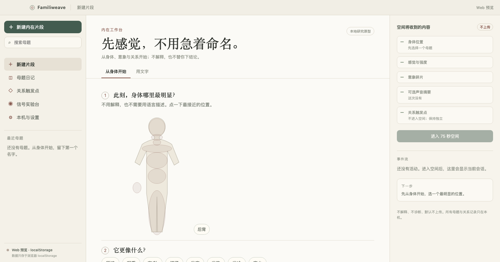

# 桌面外壳：Tauri 2 + 三栏工作台

日期：2026-11-01。状态：外壳与前端已搭建；Tauri Rust 已通过 `cargo check`，并在完整宿主权限下成功启动窗口。打包与正式签名/公证尚未验收。



## 1. 结构

```text
apps/desktop/
  package.json                # 只负责 Tauri 的 beforeDev/beforeBuild 委托
  src-tauri/
    Cargo.toml
    tauri.conf.json
    src/lib.rs                # Rust 宿主
    src/main.rs
    capabilities/default.json
    icons/
src/
  desktop-shell.tsx           # 三栏外壳
  shell.css                   # 参考 inceptless 的暖纸面美术
  host.ts                     # Tauri invoke 桥；Web 预览时降级
```

- 前端：React 19 + TypeScript + Vite。
- 桌面宿主：Tauri 2 + Rust。
- 当前前端仍以 `localStorage` 为数据源；SQLite 宿主句柄已建立，但尚未迁移业务数据。

## 2. Rust 宿主

`apps/desktop/src-tauri/src/lib.rs` 提供：

| command | 用途 |
| --- | --- |
| `host_info` | 平台、版本、app data 目录、数据库路径、沙箱模式 |
| `db_status` | SQLite 是否就绪、表数量 |
| `read_local_text` | 只读 app data/local-files 下的文本，限制 1 MB |
| `write_local_text` | 只写 app data/local-files，文件名禁止路径分隔符/`..`，限制 1 MB |

- SQLite 位于 app data：`familiweave.db`。
- 已建 `local_meta` 表；业务表尚未迁移。
- 没有暴露任意文件系统路径；没有网络权限；没有 shell 插件。

## 3. 三栏工作台

参考 inceptless 的布局与暖色纸面美术：

- **左侧**：新建、搜索、导航、最近母题、宿主状态。
- **中间**：新建捕获（身体地图/文字）或母题详情（总览/身体/意象/关系）。
- **右侧**：空间将收到的内容、隐私边界、进入空间按钮、事件流占位。
- 进入空间后，中间变成 symbolic 场景；右侧显示“当前空间”。

美术：

- 背景 `#f3f0e7` / 纸面 `#fbfaf6`
- 细边框 `#ded9cc`、`#e1dbcf`
- 标题用 Georgia/宋体，正文用系统 sans
- 胶囊按钮、少量朱砂色 `#8b5e54`

## 4. 运行

Web 预览：

```sh
pnpm dev
```

桌面：

```sh
pnpm tauri:dev
```

首次会编译 Tauri Rust 依赖（数百个 crate）。`beforeDevCommand` 会启动根目录 Vite；`frontendDist` 指向根 `dist`。

## 5. 本会话验证

- `pnpm build`：通过
- `pnpm test`：51 项通过
- `cargo check --manifest-path apps/desktop/src-tauri/Cargo.toml`：通过
- `cargo test --manifest-path apps/desktop/src-tauri/Cargo.toml`：2 个宿主沙箱测试通过
- `pnpm tauri:dev`：Vite 启动、Rust 编译完成；普通工作区沙箱下 WebKit 写入被拒绝。使用完整宿主权限重试后窗口进程成功启动，无 setup 错误。**打包、签名与正式安装包尚未验收。**
- Web 预览截图：见上方图片。

## 6. 下一步

1. 在正常 macOS 用户会话运行 `pnpm tauri:dev`，验证窗口、拖拽区、交通灯位置。
2. 把母题/关系/信号从 `localStorage` 迁移到 Rust SQLite（通过 `invoke`，不暴露路径）。
3. 增加导出/导入命令与 app data 文件沙箱测试。
4. 打包：`pnpm tauri:build`（需要签名/公证时再配置）。
